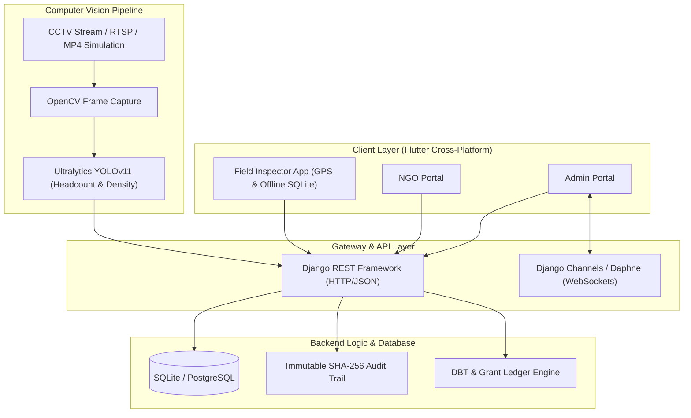

# DRISHTI (दृष्टि)
### AI-Powered Automated Monitoring, Inspection & Verification Platform
*Developed for the Ministry of Social Justice & Empowerment (MoSJE), Government of India • Smart India Hackathon (SIH)*

---

## 📖 Description

**DRISHTI** (दृष्टि) is an end-to-end governance and compliance monitoring ecosystem built to ensure absolute transparency, accountability, and real-time verification in government-aided NGO institutions, rehabilitation centers, and vocational training facilities.

The platform bridges the gap between central ministries, non-governmental organizations, and on-ground field inspectors by integrating:
- **Ultralytics YOLOv11 Computer Vision**: Real-time CCTV frame sampling and automated headcount inference for classroom and facility monitoring.
- **Geo-Locked & Cryptographically Verified Inspections**: Offline-first mobile field audit system requiring GPS perimeter validation and generating immutable SHA-256 digital signatures for submitted reports.
- **Unified Tri-Portal Architecture**: Dedicated responsive portals for Ministry Administrators, NGO Representatives, and Field Auditors.
- **Encrypted Tele-Audit Teleconferencing**: Integrated secure WebRTC video audit room with live note logging directly onto the ministerial dossier ledger.

---

## 📑 Table of Contents

- [Key Features](#-key-features)
- [System Architecture](#-system-architecture)
- [Tech Stack & Prerequisites](#-tech-stack--prerequisites)
  - [Frontend / Cross-Platform Mobile App](#frontend--cross-platform-mobile-app)
  - [Backend & AI Services](#backend--ai-services)
  - [Prerequisites](#prerequisites)
- [Installation and Setup Guide](#-installation-and-setup-guide)
  - [1. Clone the Repository](#1-clone-the-repository)
  - [2. Backend Setup (Django & YOLOv11)](#2-backend-setup-django--yolov11)
  - [3. Database Initialization & Seeding](#3-database-initialization--seeding)
  - [4. Frontend Setup (Flutter App)](#4-frontend-setup-flutter-app)
- [Usage Examples & Visuals](#-usage-examples--visuals)
  - [1. Tri-Role Selection Portal](#1-tri-role-selection-portal)
  - [2. MoSJE Administrator Console](#2-mosje-administrator-console)
  - [3. CCTV & YOLOv11 AI Headcount Engine](#3-cctv--yolov11-ai-headcount-engine)
  - [4. Geo-Fenced Field Inspector Flow](#4-geo-fenced-field-inspector-flow)
  - [5. NGO Self-Service Portal](#5-ngo-self-service-portal)
- [API Endpoints Overview](#-api-endpoints-overview)
- [License](#-license)

---

## 🌟 Key Features

| Module | Core Capabilities |
| :--- | :--- |
| **Ministry Admin Dashboard** | Interactive India GIS map, grant utilization tracking, dynamic anomaly detection, project portfolio deep-dives, audit log inspection. |
| **YOLOv11 AI Surveillance** | 16:9 adaptive CCTV inference feed with real-time headcount detection, script output terminal (`resources/test.py`), and dynamic risk scoring. |
| **Field Inspector App** | GPS geofence locking (enforces on-site presence), offline SQLite cache, tamper-evident SHA-256 evidence hashing, multi-step checklist auditing. |
| **NGO Dashboard & Registry** | Institutional registration questionnaire with auto-generated registration keys, milestone progress reporting, and PFMS DBT grant ledger tracking. |
| **Encrypted Tele-Audit** | Integrated WebRTC teleconferencing with live geo-stamps, AES-256 encryption indicators, and ministerial note capture. |

---

## 🏗 System Architecture



---

## 💻 Tech Stack & Prerequisites

### Frontend / Cross-Platform Mobile App
- **Framework**: [Flutter](https://flutter.dev/) (v3.24+ / 3.27+) with Material 3 Design
- **Language**: [Dart](https://dart.dev/) (SDK `>=3.0.0 <4.0.0`)
- **Key Packages**:
  - `geolocator`: GPS positioning & coordinate perimeter geofencing
  - `crypto`: SHA-256 cryptographic hashing for report tamper prevention
  - `flutter_map` & `latlong2`: Interactive OpenStreetMap / GIS rendering
  - `sqflite` & `path`: Offline-first database caching
  - `http`: REST API networking & media fetching
  - `intl`: Indian Rupee (`₹`) currency & regional date formatting

### Backend & AI Services
- **Web Framework**: [Django 5.x](https://www.djangoproject.com/) & [Django REST Framework](https://www.django-rest-framework.org/)
- **Real-Time WebSockets**: [Django Channels](https://channels.readthedocs.io/) & [Daphne](https://github.com/django/daphne)
- **Computer Vision & AI**:
  - [Ultralytics YOLOv11](https://github.com/ultralytics/ultralytics) (`yolo11n.pt`)
  - [OpenCV](https://opencv.org/) (`opencv-python-headless`)
  - [Pillow](https://python-pillow.org/)
- **Spatial Calculations**: `shapely`, `geopy`

### Prerequisites
Before running the application, make sure the following are installed:
- [Git](https://git-scm.com/)
- [Python 3.10+](https://www.python.org/downloads/)
- [Flutter SDK](https://docs.flutter.dev/get-started/install) (3.24 or newer)
- [Android Studio](https://developer.android.com/studio) / [VS Code](https://code.visualstudio.com/) with Flutter & Dart extensions
- (Optional) [Google Chrome](https://www.google.com/chrome/) for running the Flutter Web dashboard

---

## 🚀 Installation and Setup Guide

### 1. Clone the Repository
```bash
git clone https://github.com/your-username/sih-prototype.git
cd sih-prototype
```

---

### 2. Backend Setup (Django & YOLOv11)

1. **Navigate to the backend directory**:
   ```bash
   cd backend
   ```

2. **Create and activate a virtual environment**:
   - **Windows**:
     ```powershell
     python -m venv .venv
     .venv\Scripts\activate
     ```
   - **Linux / macOS**:
     ```bash
     python3 -m venv .venv
     source .venv/bin/activate
     ```

3. **Install dependencies**:
   ```bash
   pip install -r requirements.txt
   ```

4. **Verify YOLOv11 Model**:
   Ensure the `yolo11n.pt` weights file is located in `backend/` or will auto-download on first inference.

---

### 3. Database Initialization & Seeding

1. **Run Database Migrations**:
   ```bash
   python manage.py makemigrations
   python manage.py migrate
   ```

2. **Seed Mock Data (NGOs, Projects, Inspections, and Audit Trails)**:
   ```bash
   python seed_drishti.py
   ```

3. **Start the Backend Server**:
   ```bash
   python manage.py runserver 0.0.0.0:8000
   ```
   *The backend API will be available at `http://localhost:8000/`.*

---

### 4. Frontend Setup (Flutter App)

1. **Open a new terminal window** and navigate to the `mobile_app` folder:
   ```bash
   cd mobile_app
   ```

2. **Fetch Flutter packages**:
   ```bash
   flutter pub get
   ```

3. **Run Code & Layout Analysis**:
   ```bash
   flutter analyze lib
   ```

4. **Run the Application**:
   - **On Connected Android Device / Emulator**:
     ```bash
     flutter run -d android
     ```
   - **On Chrome (Web App)**:
     ```bash
     flutter run -d chrome
     ```
   - **On Windows Desktop**:
     ```bash
     flutter run -d windows
     ```

---

## 📸 Usage Examples & Visuals

### 1. Tri-Role Selection Portal
Upon launching the application, users are greeted by the Ministry of Social Justice & Empowerment landing page:
```
+-----------------------------------------------------------------------------------+
|  🇮🇳  GOVERNMENT OF INDIA • MINISTRY OF SOCIAL JUSTICE & EMPOWERMENT                |
|                                                                                   |
|                   DRISHTI MONITORING & VERIFICATION SYSTEM                        |
|                                                                                   |
|   [ 🏛️ Ministry Admin Portal ]   [ 🏢 NGO Portal ]   [ 📋 Field Inspector Portal ] |
+-----------------------------------------------------------------------------------+
```
- **Admin Portal**: Full oversight, project approvals, CCTV feeds, and tele-audits.
- **NGO Portal**: Self-registration, milestone progress tracking, and DBT ledger.
- **Inspector Portal**: Location-validated field audits and evidence logging.

---

### 2. MoSJE Administrator Console
- **Interactive GIS Map**: Visualizes NGO distribution and inspection compliance levels across Indian states.
- **Scheme Financial Tracker**: Real-time comparison of sanctioned amounts vs. PFMS-disbursed grants vs. verified utilization.
- **Direct Video Tele-Audit**: One-click encrypted WebRTC call to verified NGO center heads with live note entry into the official ledger.

---

### 3. CCTV & YOLOv11 AI Headcount Engine
Integrated directly under **Project Details → CCTV & AI Surveillance**:
```
+-----------------------------------------------------------------------------------+
| Classroom CCTV & YOLOv11 Headcount Engine               [ 🔴 LIVE AI STREAM ]     |
| OpenCV Frame Sampling • Ultralytics YOLOv11 Detection                             |
+-----------------------------------------------------------------------------------+
| +-------------------------------------------------------------------------------+ |
| | [🟢 HEADCOUNT: 14]                                   [⚡ YOLOv11n • Conf: 0.15] | |
| |                                                                               | |
| |               [ Full 16:9 Uncropped Classroom CCTV Camera Stream ]             | |
| |                                                                               | |
| | [🕒 2026-10-21 10:45:02 IST • Camera #01 Dwarka Sector 10]                    | |
| +-------------------------------------------------------------------------------+ |
+-----------------------------------------------------------------------------------+
| >_ YOLOv11 SCRIPT OUTPUT: resources/test.py                       [ COMPLETED ]   |
| --------------------------------------------------------------------------------- |
| [YOLOv11] Initializing PyTorch on CUDA / CPU...                                   |
| [YOLOv11] Loaded weights: yolo11n.pt (Classes: person [0])                        |
| [YOLOv11] Video feed: resources/simulated_classroom_cctv.mp4                      |
| [YOLOv11] Frame #420: 14 heads detected (Confidence avg: 0.84)                    |
| [DRISHTI-AI] Headcount delta vs registered attendance: +0.0% (VERIFIED)           |
+-----------------------------------------------------------------------------------+
```

---

### 4. Geo-Fenced Field Inspector Flow
Field auditors follow an enforced 4-step offline-first protocol:
1. **Geo-Location Check**: App queries device GPS coordinates via `geolocator`. If the auditor is outside the registered center radius (e.g. `> 150m`), submission is disabled.
2. **Infrastructure Checklist**: Step-by-step verification (classrooms, computer labs, wheelchair ramps, CCTV cameras, biometric kiosks).
3. **Photo Evidence Capture**: Timestamped on-site photos of infrastructure and attendance logs.
4. **Cryptographic Signing**: Generates a tamper-proof SHA-256 hash stamp:
   ```
   SHA-256: 4f8b2c179e0a6d328b9351e2bcde78f10a234e9128549301da2834bdf7918a03
   Status: Verified & Synced to Ministry Audit Trail
   ```

---

### 5. NGO Self-Service Portal
- **Activation Key Generation**: Auto-generates cryptographically structured keys (e.g., `AKSH1-78923-DEL01-99824-MOSJE`) upon completing the institutional questionnaire.
- **Responsive Layout**: Form rows and action controls adapt seamlessly to small-screen smartphones and tablets without pixel overflow errors.

---

## 📡 API Endpoints Overview

| Method | Endpoint | Description |
| :--- | :--- | :--- |
| `GET` | `/api/centers/organizations/` | Retrieve list of registered NGOs & facilities |
| `POST` | `/api/centers/organizations/` | Submit NGO registration questionnaire |
| `GET` | `/api/centers/projects/` | Retrieve sanctioned projects & funding status |
| `GET` | `/api/ai/cctv-stream/` | Stream processed YOLOv11 annotated video frames |
| `POST` | `/api/ai/run-yolo/` | Trigger ad-hoc YOLO inference on a target center |
| `GET` | `/api/inspections/` | List assigned & completed field audits |
| `POST` | `/api/inspections/submit/` | Submit SHA-256 signed field inspection report |
| `GET` | `/api/inspections/audit-logs/` | Query immutable system audit trail |

---

## 📄 License

This prototype is developed under the **Smart India Hackathon (SIH)** initiative for the **Ministry of Social Justice & Empowerment (MoSJE), Government of India**. Distributed under the [MIT License](LICENSE).
